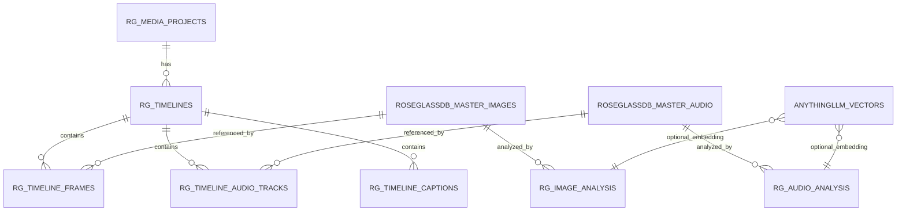

# Multimodal Core: Image + Music + Video (Frame Sequence + Audio Track)

This proposes a **normalized timeline model** so video is stored as:

- an ordered sequence of frame references (images), and
- exactly one audio track reference whose duration matches the timeline (silent is valid).

## 1) Why this avoids 5000x data blowups

Instead of writing full blobs per frame/event, store:

- media blobs once (`roseglassdb_master_images`, `roseglassdb_master_audio`),
- lightweight event rows for timeline placement,
- optional embeddings/captions/features in side tables.

That gives dedupe (via `sha256`) and reuse across projects.

## 2) Entity model (additive to your current schema)



## 3) Suggested tables

### `rg_media_projects`
- `id serial pk`
- `name text not null`
- `notes text`
- `created_at timestamptz default now()`

### `rg_timelines`
- `id serial pk`
- `project_id int not null fk -> rg_media_projects.id`
- `fps numeric(8,3) not null` (e.g. `24.000`)
- `duration_ms int not null`
- `audio_policy text not null check (audio_policy in ('required','optional'))`
- `created_at timestamptz default now()`

### `rg_timeline_frames`
- `id serial pk`
- `timeline_id int not null fk -> rg_timelines.id on delete cascade`
- `frame_index int not null` (0..N-1)
- `image_id int not null fk -> roseglassdb_master_images.id`
- `start_ms int not null`
- `duration_ms int not null`
- `unique (timeline_id, frame_index)`
- index: `(timeline_id, start_ms)`

### `rg_timeline_audio_tracks`
- `id serial pk`
- `timeline_id int not null fk -> rg_timelines.id on delete cascade`
- `audio_id int not null fk -> roseglassdb_master_audio.id`
- `role text not null check (role in ('program','silent','guide','music','fx'))`
- `offset_ms int not null default 0`
- `gain_db numeric(6,2) default 0`
- `is_primary boolean default true`
- partial unique index: one primary track per timeline

### `rg_image_analysis`
- `id serial pk`
- `image_id int not null fk -> roseglassdb_master_images.id`
- `model_name text not null`
- `caption text`
- `objects jsonb`
- `ocr_text text`
- `aesthetic_score numeric(5,2)`
- `embedding_vector_id uuid fk -> anythingllm_vectors.id`
- `created_at timestamptz default now()`

### `rg_audio_analysis`
- `id serial pk`
- `audio_id int not null fk -> roseglassdb_master_audio.id`
- `model_name text not null`
- `caption text` (music-aware natural-language summary)
- `tempo_bpm numeric(6,2)`
- `key_signature text`
- `loudness_lufs numeric(6,2)`
- `segments jsonb` (beats/sections/chords)
- `embedding_vector_id uuid fk -> anythingllm_vectors.id`
- `created_at timestamptz default now()`

### `rg_timeline_captions`
- `id serial pk`
- `timeline_id int not null fk -> rg_timelines.id on delete cascade`
- `start_ms int not null`
- `end_ms int not null`
- `source text not null check (source in ('image','audio','fusion','manual'))`
- `text caption not null`

## 4) Canonical API shapes

```json
{
  "timeline": {
    "id": 42,
    "fps": 24,
    "duration_ms": 120000,
    "frames": [
      {"frame_index": 0, "image_id": 1001, "start_ms": 0, "duration_ms": 42},
      {"frame_index": 1, "image_id": 1002, "start_ms": 42, "duration_ms": 42}
    ],
    "audio_tracks": [
      {"audio_id": 551, "role": "program", "offset_ms": 0, "is_primary": true}
    ]
  }
}
```

If no real soundtrack exists, create/import a silent WAV in `roseglassdb_master_audio` and attach it as primary.

## 5) Frontend architecture

Use 3-pane UX:

1. **Asset pane**: searchable image/audio library + analysis badges.
2. **Timeline pane**: frame strip + audio waveform row.
3. **Caption pane**: generated captions with source tags (`image/audio/fusion`).

Key interactions:

- drag image -> inserts frame event at frame index
- drag audio -> assigns/replaces primary track
- click “Analyze” -> queues image/audio analysis jobs
- click “Generate Fusion Captions” -> aligns frame windows with audio segments

## 6) Sync logic (core invariants)

- `timeline.duration_ms == max(frame_end_ms, primary_audio_end_ms)`
- every timeline has exactly one `is_primary=true` audio track
- frame order is deterministic by `frame_index`
- export encoders read timeline rows (not raw blobs) and stream files by reference

## 7) Compression / storage strategy

- keep `bytes` nullable in master tables and prefer `external_path`
- dedupe via `sha256`
- for repeated frames, reference same `image_id` across many indices
- materialize previews/waveforms only once (`thumbnail_bytes`, `waveform_bytes`)

